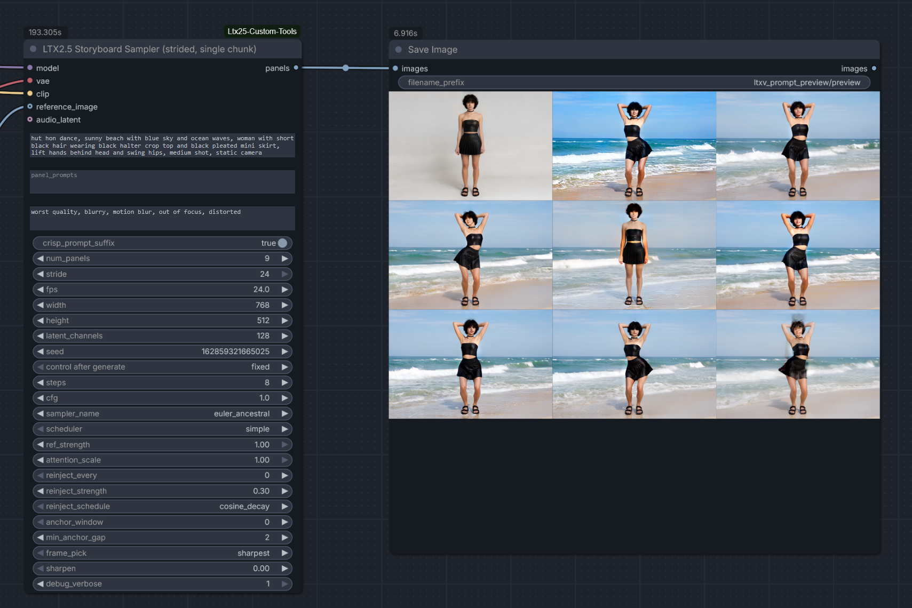

# LTX 2.5 Storyboard Strided

A ComfyUI extension for generating storyboard panels and keyframe sequences for LTX Video 2.5 workflows.

`LTX25StoryboardStrided` is designed as a Stage-One storyboard planning node. It generates a sequence of storyboard panels from text prompts before video generation, allowing creators to establish scene progression, composition, pacing, and visual continuity.

The node outputs decoded images that can be reviewed, refined, and used as visual guidance for later LTX Video generation stages.

---


## Features

- Storyboard-first workflow
- Generates decoded storyboard panel images
- Optional image reference support
- Multiple progression modes
- Designed for LTX Video 2.5 models
- Useful for narrative, cinematic, and long-form video projects
- Supports keyframe planning before video generation

---

## Node

### LTX25StoryboardStrided

Stage-One storyboard generation node.

### Inputs

| Input | Type | Description |
|---------|---------|---------|
| MODEL | MODEL | LTX 2.5 diffusion model |
| VAE | VAE | Used to decode generated storyboard panels |
| CLIP | CLIP | Text encoder used for prompt conditioning |
| IMAGE | IMAGE (optional) | Reference image used by supported modes |

### Outputs

| Output | Type |
|----------|----------|
| IMAGE | Decoded storyboard panel images |

---

## Modes

### lowfps_clip

Generates storyboard panels using low-frame-rate video conditioning.

Useful for creating a sparse sequence of major visual beats while maintaining stronger temporal consistency than independent generation.

Recommended for:

- Storyboarding video scenes
- Scene planning
- Establishing major compositions

---

### sequential

Generates each panel from the previous panel.

This mode intentionally accumulates changes over time.

**Drift is expected and is part of the design.**

Useful for:

- Character evolution
- Progressive transformations
- Environmental transitions
- Motion and progression studies

---

### independent_from_reference

Generates each storyboard panel independently using the supplied reference image and per-line prompts.

Each prompt line becomes its own storyboard panel while retaining reference-image guidance.

Useful for:

- Shot lists
- Comics
- Storyboards
- Consistent character design
- Scene exploration

---

### strided_positions

Experimental storyboard generation mode.

Uses temporal conditioning derived from:

```text
frame_rate = fps / stride
```

Rather than generating strictly sequential frames, the node conditions on temporally separated positions along an implied timeline.

Useful for:

- Keyframe extraction
- Large scene transitions
- Video planning
- Sparse storyboard generation

Because this mode uses synthetic temporal spacing, results may vary depending on stride values and prompt structure.

---

## Example Workflow

```text
MODEL
  │
VAE
  │
CLIP
  │
Prompt Sequence
  │
(Optional Reference Image)
  │
▼
LTX25StoryboardStrided
  │
▼
Storyboard Panels
  │
▼
Shot Selection / Refinement
  │
▼
LTX Video Generation
```

---

## Prompting Tips

### Sequential Narrative

```text
A lone explorer enters an abandoned station

The explorer discovers a glowing control room

Ancient machinery begins to reactivate

The station lights return

The explorer looks toward a distant starship
```

Works especially well in:

- `sequential`
- `strided_positions`

---

### Consistent Character Planning

Use a reference image and one prompt per line:

```text
close-up portrait

walking through city street

entering café

sitting at table

looking out window
```

Works best in:

- `independent_from_reference`

---

## Recommended Uses

- Storyboard creation
- Shot planning
- Multi-scene video projects
- Character consistency studies
- Cinematic sequencing
- Pre-visualization
- Narrative development

---

## Installation

Clone into your ComfyUI custom nodes folder:

```bash
cd ComfyUI/custom_nodes

git clone https://github.com/mambobanda/LTX2.5-Storyboard-Sampler.git
```

Restart ComfyUI.

---

## Requirements

- ComfyUI
- LTX Video 2.5
- Python 3.10+

---

## Notes

- `sequential` intentionally accumulates visual drift.
- `independent_from_reference` generates panels independently.
- `strided_positions` is experimental and may evolve in future releases.
- Storyboard outputs are decoded images rather than latent representations.

---

## Credits

Created by Mambo for the ComfyUI and LTX Video community.

---

## License

MIT License
